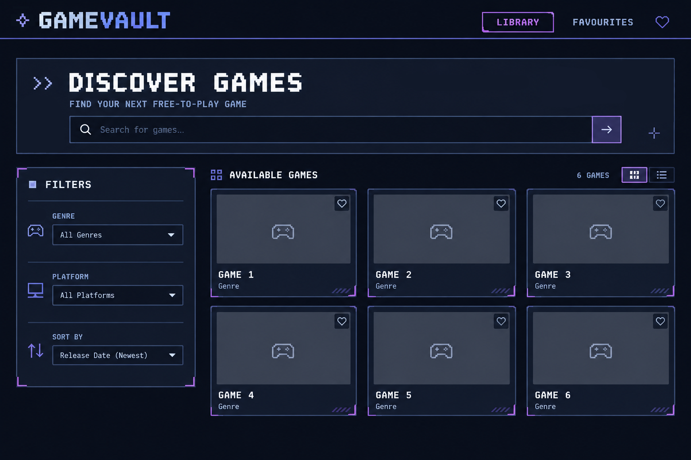
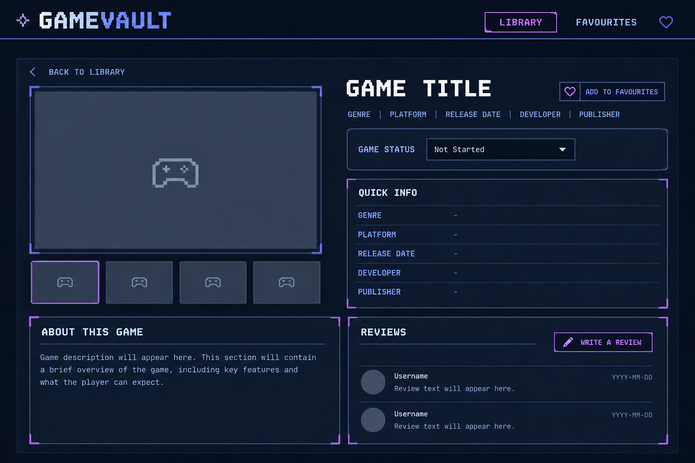

# GameVault — Project Proposal

**Course:** CSCI 3230U  
**Milestone:** M1 — Proposal and Static Prototype  
**Project Name:** GameVault

## 1. Project Overview

GameVault is a web application designed to help users discover, explore, and organise free-to-play video games. The application will feature a searchable game library where users can browse games, filter by genre or platform, and view detailed information about individual titles. Users will also be able to save their favourite games, leave personal reviews, and track whether they want to play, are currently playing, or have completed a game. The aim is to create a straightforward and visually appealing platform that combines game discovery with personal collection management.

## 2. Data Source

**API:** FreeToGame API  
**Documentation:** https://www.freetogame.com/api-doc  
**Endpoint:** https://www.freetogame.com/api/games

GameVault will use the FreeToGame API to retrieve information about free-to-play video games, including their titles, descriptions, cover images, genres, platforms, publishers, and release dates.

### API Research and Testing

RAWG was initially considered as the data source. However, problems with account registration and login prevented access to an API key.

FreeToGame was selected as an alternative because its public games endpoint does not require an API key.

The endpoint was tested directly in a browser and through JavaScript's fetch() function in the developer console. Both tests succeeded, with the JavaScript request returning 419 games without CORS errors.

### Sample JSON Response

The example below illustrates the fields GameVault intends to use. 

```json
{
  "id": 540,
  "title": "Overwatch",
  "thumbnail": "https://www.freetogame.com/g/540/thumbnail.jpg",
  "short_description": "A hero-focused first-person team shooter from Blizzard Entertainment.",
  "genre": "Shooter",
  "platform": "PC (Windows)",
  "publisher": "Activision Blizzard",
  "developer": "Blizzard Entertainment",
  "release_date": "2022-10-04"
}
```

### How the Data Will Be Used

GameVault will use API data to generate game cards containing titles, images, and genres. Selecting a game will open a dedicated detail page displaying additional information.

Search, filtering, and sorting will allow users to find games more easily. Personal information such as favourites, reviews, and game progress will be stored locally in the browser rather than submitted to the FreeToGame API.

## 3. Comparable Applications

### Backloggd
https://www.backloggd.com/

Backloggd has a well-organised interface that allows users to explore and track games. One particularly useful feature is its individual game pages, which display available platforms, descriptions, genres, average user ratings, wishlist counts, and player activity.

GameVault will take inspiration from the structure of these detail pages while keeping the interface focused on essential information.

### IGDB
https://www.igdb.com/

IGDB provides extensive information about games, including developers, publishers, game modes, and player perspectives. Although this information is useful, the amount displayed can make its interface feel cluttered visually.

One feature worth incorporating into GameVault is its Similar Games section, which helps users discover related titles.

GameVault will aim for a simpler presentation while retaining useful discovery features.

### FreeToGame
https://www.freetogame.com/

FreeToGame provides a catalogue of free-to-play games with detailed information and community feedback.

Its circular rating indicator is particularly appealing because it fits the visual style of a gaming website. The Like, Meh, and Dislike voting system also provides an accessible way to understand community opinions.

GameVault may take inspiration from these visual features, although user ratings would need to be handled separately if the API does not provide that data.

### How GameVault Will Differ

GameVault will combine game discovery and personal collection management in a single interface.

Unlike larger databases containing extensive information, GameVault will focus on essential game details and allow users to organise their gaming activity.

The application will use a retro gaming-inspired design while maintaining modern accessibility and responsive layouts.

## 4. Feature Plan

### Core Features

- **Game Library:** Display available games as cards with images and basic information.
- **Search:** Find games by title.
- **Filtering:** Filter games by genre and platform.
- **Sorting:** Organise games alphabetically or by release date.
- **Game Details:** View descriptions, platforms, release dates, and additional game information.
- **Favourites:** Add and remove games from a personal favourites collection.
- **Persistent Storage:** Store favourites and other personal data using localStorage.
- **Review Form:** Allow users to enter personal ratings or written reviews.
- **Responsive Design:** Support desktop, tablet, and mobile screen sizes.
- **Accessibility:** Use semantic HTML, labelled controls, keyboard navigation, and appropriate colour contrast.

### Additional Feature

**Game Status Tracking**

Users will be able to assign games one of three statuses:

- Want to Play
- Currently Playing
- Completed

These statuses will be saved locally so users can keep track of their gaming activity between sessions.

## 5. Wireframes

The application's visual design will take inspiration from retro video game interfaces, using structured panels, pixel-inspired typography, and arcade-style visual elements.

The design will still prioritise readability, accessibility, and responsiveness.

### Game Library Page

The main library page will contain:

- Header and navigation
- Search bar
- Genre and platform filters
- Sorting options
- Grid of game cards
- Favourite controls

**Wireframe:** 

### Game Details Page

The game details page will contain:

- Game title and cover image
- Full description
- Genre and platform information
- Release date and publisher
- Favourite button
- Game status selector
- Personal review form

**Wireframe:** 

